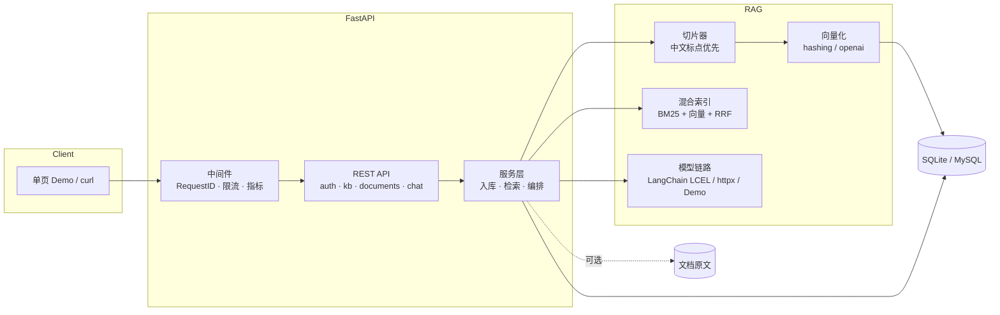

# DocMind · 多租户知识库问答服务

<p>
  
  
  
  
  
</p>

把一堆散落的 PDF / Markdown 变成「能问答、可溯源、可多租户隔离」的知识库服务。
核心不是调通一个大模型，而是把 **检索质量、引用可信度、租户隔离、流式体验** 这四件事做扎实。

> 在线演示：`python -m uvicorn app.main:create_app --factory` 后打开 <http://127.0.0.1:8000/ui/>
> 演示模式（`DOCMIND_LLM_PROVIDER=demo`）不需要任何 API Key，也不联网。

---

## 目录

- [这个项目解决什么问题](#这个项目解决什么问题)
- [功能清单](#功能清单)
- [架构](#架构)
- [快速开始](#快速开始)
- [配置项](#配置项)
- [API](#api)
- [关键设计](#关键设计)
- [评测与压测结果](#评测与压测结果)
- [测试](#测试)
- [目录结构](#目录结构)
- [已知限制](#已知限制)
- [Roadmap](#roadmap)

---

## 这个项目解决什么问题

企业里 80% 的「AI 问答」需求，本质是同一个问题：**员工问一句话，系统要从内部文档里找到依据，再组织成答案，并且能点开看原文**。

直接用大模型答会有两个致命问题：编造（幻觉）和不可追溯。DocMind 的思路是：

1. **先检索，再生成**：只把检索到的片段喂给模型，Prompt 里明确「资料里没有就说没有」；
2. **答案带引用**：每个结论后标注 `[1]`，前端可点开对应切片原文；
3. **检索做混合**：BM25 抓专有名词/错误码，向量抓语义相近，RRF 融合；
4. **多租户隔离**：`tenant_id` 行级隔离，越权统一返回 404（不泄露资源是否存在）。

## 功能清单

| 模块 | 能力 | 状态 |
| --- | --- | --- |
| 认证 | 注册 / 登录 / JWT（HS256，自实现）/ PBKDF2 口令散列 | ✅ |
| 知识库 | 多租户 CRUD、同租户重名校验 | ✅ |
| 文档 | txt / md / pdf 上传、GBK 兼容、SHA256 幂等去重、切片入库 | ✅ |
| 检索 | BM25 + 向量召回 + RRF 融合、三种模式（hybrid / keyword / vector）、可返回各路排名 | ✅ |
| 问答 | SSE 流式、引用溯源、多轮会话记忆、非流式调试接口 | ✅ |
| 工程 | Prometheus 指标、请求 ID、滑动窗口限流、统一错误体、Docker、CI | ✅ |
| 评测 | 离线 recall@k / MRR 脚本 + 16 条标注集 | ✅ |
| 前端 | 零构建单页 Demo（原生 JS，SSE 渲染） | ✅ |

## 架构



请求链路（提问）：

```text
POST /api/v1/kbs/{id}/chat
  → 鉴权 + 租户校验（404 而不是 403）
  → 取该知识库的索引（按版本号缓存，入库后自动失效）
  → query 向量化 → BM25 召回 + 向量召回 → RRF 融合 → top_k
  → Prompt 组装（带编号资料）→ LLM 流式生成
  → SSE: meta(引用) → token × N → done
  → 异步落库会话消息
```

## 快速开始

```bash
# 1) 装依赖（最小集合，不含 LangChain）
pip install -r requirements.txt

# 2) 起服务（演示模式，无需 API Key）
uvicorn app.main:create_app --factory --reload --port 8000

# 3) 灌演示数据（4 篇客服文档 + 一轮问答）
python scripts/seed_demo.py
```

打开 <http://127.0.0.1:8000/docs> 看接口，或 <http://127.0.0.1:8000/ui/> 用页面聊。

接入真实模型（DeepSeek / 通义 / vLLM / Ollama 均可，只要是 OpenAI 兼容接口）：

```bash
pip install -e ".[llm]"
export DOCMIND_LLM_PROVIDER=openai
export DOCMIND_LLM_BASE_URL=https://api.deepseek.com/v1
export DOCMIND_LLM_API_KEY=sk-xxxx
uvicorn app.main:create_app --factory
```

用 Docker：

```bash
docker compose up --build -d      # 服务在 :8000
docker compose --profile postgres up -d   # 需要 PostgreSQL 时
```

## 配置项

全部通过环境变量（前缀 `DOCMIND_`）或 `.env` 注入，代码见 `app/config.py`。

| 变量 | 默认值 | 说明 |
| --- | --- | --- |
| `DOCMIND_DATABASE_URL` | `sqlite:///./docmind.db` | 生产建议 PostgreSQL |
| `DOCMIND_JWT_SECRET` | dev 占位值 | **上线必须替换** |
| `DOCMIND_LLM_PROVIDER` | `demo` | `demo` / `openai` |
| `DOCMIND_LLM_BASE_URL` | `https://api.deepseek.com/v1` | OpenAI 兼容地址 |
| `DOCMIND_EMBEDDING_PROVIDER` | `hashing` | `hashing` / `openai` |
| `DOCMIND_CHUNK_SIZE` / `_OVERLAP` | 420 / 80 | 切片长度与重叠 |
| `DOCMIND_TOP_K` | 5 | 默认召回数 |
| `DOCMIND_RETRIEVAL_VECTOR_WEIGHT` | 0.35 | RRF 中向量通道权重 |
| `DOCMIND_RATE_LIMIT_PER_MINUTE` | 120 | 每用户/IP 每分钟请求数 |

## API

| 方法 | 路径 | 说明 |
| --- | --- | --- |
| POST | `/api/v1/auth/register` | 注册（自动开通租户） |
| POST | `/api/v1/auth/login` | 登录，返回 JWT |
| GET | `/api/v1/auth/me` | 当前用户 |
| POST | `/api/v1/kbs` | 建知识库 |
| GET | `/api/v1/kbs` | 我的知识库 |
| DELETE | `/api/v1/kbs/{kb_id}` | 删知识库（级联切片） |
| POST | `/api/v1/kbs/{kb_id}/documents` | 上传文档（multipart） |
| GET | `/api/v1/kbs/{kb_id}/documents` | 文档列表 |
| DELETE | `/api/v1/kbs/{kb_id}/documents/{doc_id}` | 删文档 |
| POST | `/api/v1/kbs/{kb_id}/search` | 混合检索（不调模型） |
| POST | `/api/v1/kbs/{kb_id}/chat` | 问答（默认 SSE） |
| GET | `/api/v1/kbs/{kb_id}/sessions` | 会话列表 |
| GET | `/healthz` `/readyz` `/metrics` | 运维接口 |

```bash
TOKEN=$(curl -s -X POST localhost:8000/api/v1/auth/register \
  -H 'Content-Type: application/json' \
  -d '{"email":"a@b.com","password":"Passw0rd!"}' | python -c 'import sys,json;print(json.load(sys.stdin)["access_token"])')

KB=$(curl -s -X POST localhost:8000/api/v1/kbs \
  -H "Authorization: Bearer $TOKEN" -H 'Content-Type: application/json' \
  -d '{"name":"客服库"}' | python -c 'import sys,json;print(json.load(sys.stdin)["id"])')

curl -s -X POST localhost:8000/api/v1/kbs/$KB/documents \
  -H "Authorization: Bearer $TOKEN" -F file=@data/corpus/refund-policy.md

curl -s -X POST localhost:8000/api/v1/kbs/$KB/chat \
  -H "Authorization: Bearer $TOKEN" -H 'Content-Type: application/json' \
  -d '{"question":"退款多久到账？"}'
```

SSE 返回：

```text
event: meta
data: {"session_id":1,"mode":"demo","citations":[{"index":1,"filename":"refund-policy.md",...}]}

event: token
data: {"text":"退款审核通过后"}

event: done
data: {"session_id":1,"chars":128,"latency_ms":9}
```

## 关键设计

### 1. 为什么是混合检索，而不是「向量库一把梭」

中文场景里，**专有名词、错误码、版本号** 这类查询靠语义向量很容易漂，而 BM25 是精确匹配的强项；反过来，用户换个说法问同一件事时，BM25 又完全抓不到。两路召回后用 RRF 融合，只依赖排名、不依赖分数尺度，天然回避「BM25 分数 0~30、余弦 0~1 不可比」的问题。

代价是：**融合权重必须与向量质量匹配**。我用同一份语料扫了一遍权重（下表），哈希向量下权重越大反而越差——因为哈希向量只有字面相似度，没有语义泛化，等权融合是在稀释 BM25 的强信号。这个结论直接决定了默认值取 0.35，而不是拍脑袋取 1.0。

### 2. 索引按「版本号」懒加载

每次查询都重建索引会拖慢接口，常驻内存又要处理一致性。做法是给每个知识库算一个版本 `(切片数, 最大切片id)`，入库/删除必然改变其一；查询时先比版本，不一致才重建。代价是每次查询多一条 `COUNT/MAX` 的 SQL（毫秒级），换来的是**不需要在业务代码里手工 `invalidate`**，少一类「忘记刷新索引」的 bug。

### 3. 同步会话 + 异步流式

入库、检索、CRUD 都是同步 SQLAlchemy Session，跑在 FastAPI 的线程池里；只有「生成」这一段是 `async`。理由：SQLite/MySQL 的同步驱动成熟稳定，而流式生成必须异步，两条链路各用各的模型，不强行统一。上传接口里用 `run_in_threadpool` 把解析+向量化丢出事件循环，否则一个 5MB 文档就能把同进程的 SSE 全部卡住。

### 4. 引用是「结构化字段」，不是字符串

`citations` 是数组，每项含 `doc_id / filename / chunk_ordinal / snippet / score`，前端用它渲染可点击的出处。**没有把 `[1]` 直接塞进正文让前端做正则**——那样一旦模型编了个 `[9]` 就无从校验。现在引用编号由后端按召回顺序生成，参数和返回永远对得上。

### 5. 越权返回 404，不返回 403

`403` 等于告诉攻击者「这个 id 存在，只是不属于你」，可以拿来枚举。所有跨租户访问统一 404，日志里才记录真实原因。

## 评测与压测结果

### 检索评测（真实运行，非估算）

```bash
python scripts/eval_retrieval.py
```

语料：4 篇客服文档 / 7 个切片；评测集：16 条人工标注查询；向量：384 维哈希；`top_k=5`。

| mode | recall@1 | recall@3 | recall@5 | MRR |
| --- | --- | --- | --- | --- |
| hybrid（w=0.35） | **1.000** | 1.000 | 1.000 | **1.000** |
| keyword（纯 BM25） | 1.000 | 1.000 | 1.000 | 1.000 |
| vector（纯向量） | 0.688 | 0.875 | 0.875 | 0.781 |

融合权重扫描（同一份语料、同一套查询）：

| 向量权重 | recall@1 | MRR |
| --- | --- | --- |
| 0（等价纯 BM25） | 1.000 | 1.000 |
| 0.30 | 1.000 | 1.000 |
| **0.35（默认）** | **1.000** | **1.000** |
| 0.60 | 0.938 | 0.958 |
| 1.20 | 0.812 | 0.896 |

结论：**在这份小语料 + 哈希向量下，BM25 已经很强，向量通道是「锦上添花」而不是「雪中送炭」**。这也说明为什么默认权重取 0.35；如果换成真实语义向量（`DOCMIND_EMBEDDING_PROVIDER=openai`），应当重新跑这张表再调权重。

> 坦白讲：16 条查询的评测集很小，`recall@5=1.0` 不能证明泛化能力，只能证明「这条链路是通的、可回归的」。真正的价值是**有评测脚本**，改检索逻辑时能立刻看出是变好还是变差。

### 接口压测

```bash
python scripts/bench_api.py --concurrency 10 --requests 300
```

本机：Intel64 Family 6 Model 183（20 逻辑核）/ Windows / SQLite / uvicorn 单 worker / `demo` 模式（不调外部模型）。

| 目标接口 | 并发 | 请求数 | 吞吐 | P50 | P95 | P99 | 错误 |
| --- | --- | --- | --- | --- | --- | --- | --- |
| `POST /search`（混合检索） | 10 | 300 | **280 req/s** | 34.0 ms | 50.2 ms | 56.1 ms | 0 |

单请求里 CPU 大头是纯 Python 的 BM25 + 余弦打分（7 个切片、384 维）；切片量上千时应换 numpy 向量化或 FAISS，这一点在 Roadmap 里。

## 测试

```bash
python -m pytest -q          # 装了 pytest
python -m unittest discover -s tests -t .   # 零额外依赖
```

当前 **61 个单元/集成测试全部通过**，覆盖：

- 口令散列（随机 salt、错误口令、畸形散列）与 JWT（过期、篡改、错误密钥）
- 中文分词、切片长度/重叠/空输入边界
- 哈希向量的确定性、归一化、相似度序关系
- BM25 命中、RRF 融合、空索引、top_k 截断
- 完整 API 链路：注册→建库→上传→检索→问答→会话
- 租户隔离（越权 404）、重复文档 409、空文件 400、参数校验 422
- SSE 事件序列（meta → token → done）与引用字段
- 限流窗口滑动与指标文本格式

## 目录结构

```text
docmind-rag/
├── app/
│   ├── main.py              # 装配：中间件、路由、lifespan
│   ├── config.py            # env/.env 配置
│   ├── db.py                # 引擎、Session、UTC 时间类型
│   ├── models.py            # 6 张表
│   ├── security.py          # PBKDF2 + HS256 JWT
│   ├── errors.py            # 统一错误体
│   ├── metrics.py           # Prometheus 文本格式
│   ├── rate_limit.py        # 滑动窗口限流
│   ├── deps.py              # 依赖注入
│   ├── api/                 # auth / kb / documents / chat / system
│   ├── rag/                 # text / embeddings / index / prompts / llm / pipeline
│   ├── services/            # ingest / retrieval
│   └── static/index.html    # 零构建 Demo 页
├── data/corpus/             # 演示语料
├── data/eval_set.jsonl      # 16 条标注查询
├── scripts/                 # eval / seed / bench
├── tests/                   # 61 个测试
├── docs/ARCHITECTURE.md
├── Dockerfile / docker-compose.yml
└── .github/workflows/ci.yml
```

## 已知限制

- 向量索引是暴力检索（cosine 全量比较），切片上万后需要 HNSW / FAISS / pgvector；
- 索引常驻进程内存，多实例部署时每个实例各存一份，容量规划要按副本数算；
- 限流是进程内实现，多副本要换 Redis（接口已抽象，换实现不影响中间件）；
- PDF 只做文本层抽取，扫描件需要接 OCR；
- 演示模式（demo）是抽取式摘要，不能替代真实模型，仅用于离线跑通链路与 CI。

## Roadmap

- [ ] 向量索引切换 pgvector，支持万级切片
- [ ] 检索结果做 rerank（bge-reranker / LLM 打分）
- [ ] 文档解析支持 docx / html / 表格
- [ ] 会话摘要压缩，长对话不丢上下文
- [ ] OpenTelemetry 链路追踪

## License

MIT © 2026 Tan Longping
